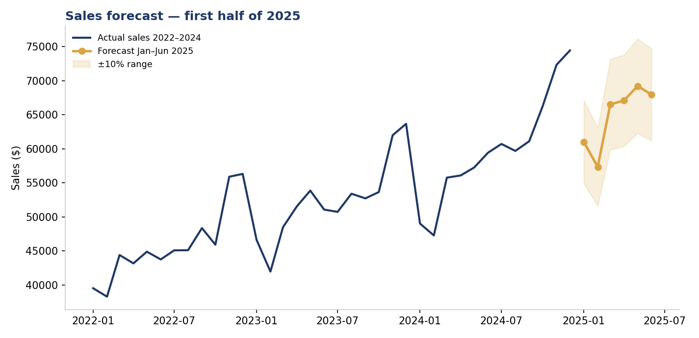
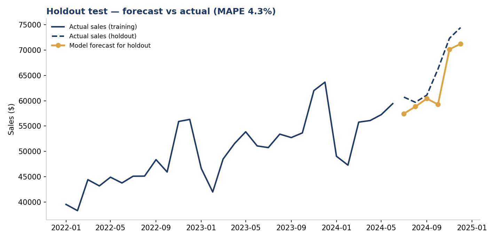
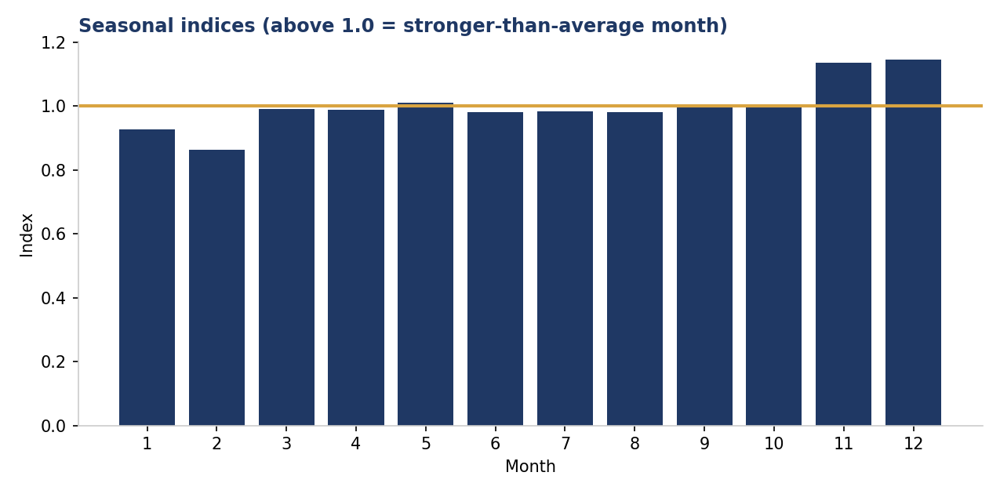

# Sales Forecasting with Python — Trend × Seasonality

**How much will we sell next quarter? This project answers it with a validated model, not a guess.**

A complete forecasting workflow over **36 months of sales data (Jan 2022 – Dec 2024)**: build a trend × seasonality model, **prove its accuracy on data it has never seen**, then forecast the first half of 2025.

## Result

| Month | Forecast |
|---|---:|
| Jan 2025 | $61,012 |
| Feb 2025 | $57,356 |
| Mar 2025 | $66,526 |
| Apr 2025 | $67,104 |
| May 2025 | $69,230 |
| Jun 2025 | $67,980 |
| **Total H1 2025** | **$389,206** |

**Model accuracy (6-month holdout): MAPE 4.3%** — on the months the model was *not* trained on, its forecasts were on average within 4.3% of actual sales. That is the number that makes a forecast safe to plan inventory, staffing and cash flow around.

## Method

1. **Trend** — linear regression of sales on time captures the steady underlying growth (~1.2%/month in this business).
2. **Seasonality** — each calendar month gets an index (its average ratio to trend). December runs at **1.15** (15% above trend); February at **0.86** — the model plans for the dip instead of being surprised by it.
3. **Validation first** — the model is trained on the first 30 months and tested on the last 6 (holdout). Only after the 4.3% MAPE check does it get refit on all 36 months for the real forecast.
4. **Range, not false precision** — every forecast ships with a ±10% planning band (`forecast_2025_H1.csv`).

## Business use

- **Inventory:** build stock for the Nov–Dec peak (index 1.14–1.15) instead of reacting to it.
- **Cash flow:** February's predictable dip (0.86) can be planned a year ahead.
- **Targets:** monthly targets set from the forecast are ambitious but grounded — the team can see exactly how each target was derived.

## Tools & skills

Python · pandas · NumPy (polyfit regression) · time-series decomposition · holdout validation / MAPE · matplotlib

## Files

| File | What it is |
|---|---|
| `data/monthly_sales.csv` | 36 months of synthetic monthly sales |
| `forecast.py` | Full pipeline: load → validate → forecast → export |
| `forecast_2025_H1.csv` | The 6-month forecast with ±10% bands |
| `charts/` | Holdout validation, future forecast, seasonal indices |

> **Note:** the dataset is synthetic (generated for portfolio purposes with realistic trend + seasonality). All results — including the 4.3% MAPE — are computed by the script from that data.

*Author: [Faheem Rind](https://github.com/orhandataanalyst) — Data Analyst · Excel · SQL · Python · Power BI*
